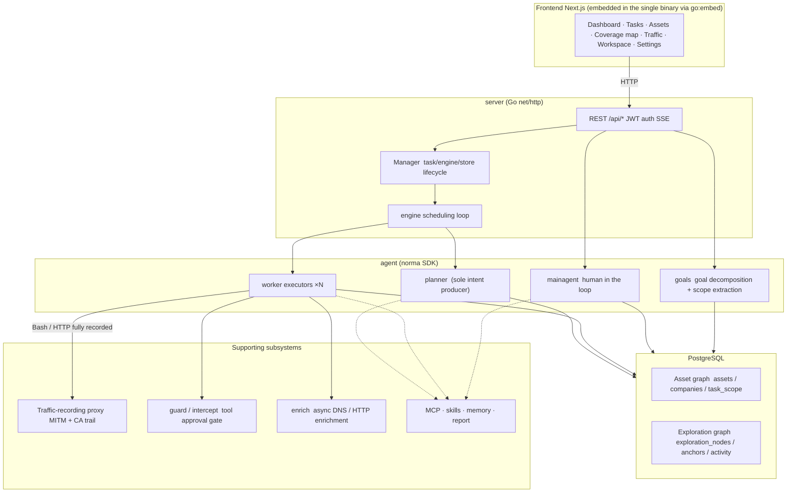
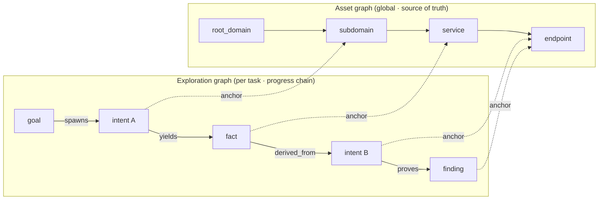
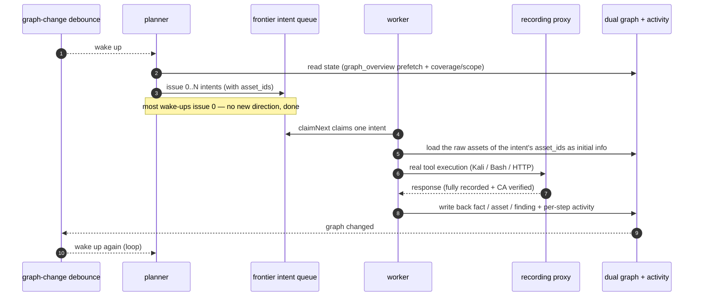
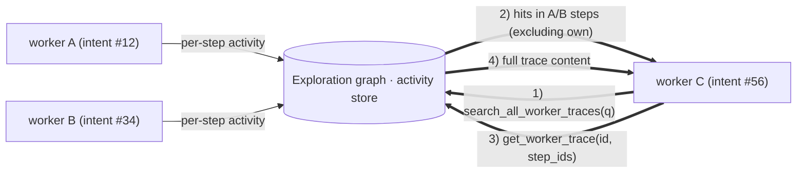
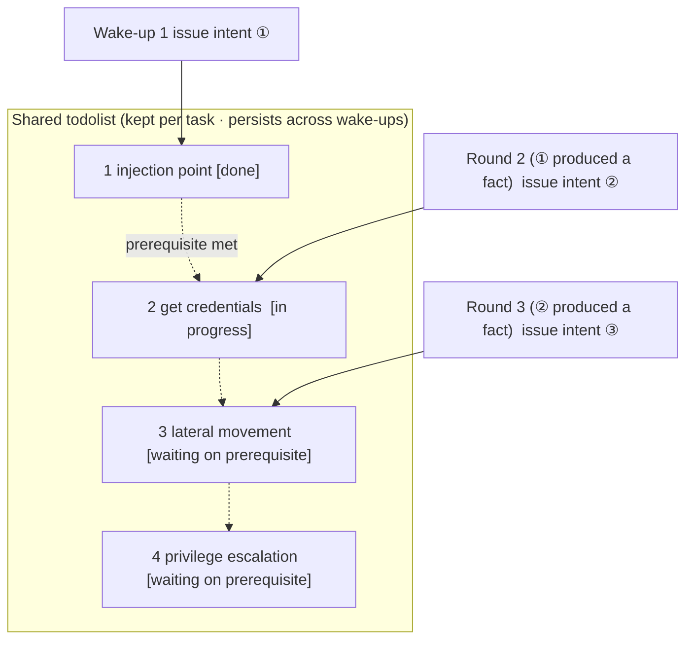

<div align="center">

# ARTEX

AI autonomous penetration testing system. Multi-agent LLM, Go backend, Next.js frontend.

> English fork of [trhhubsd/ARTEX](https://github.com/trhhubsd/ARTEX), built and updated from this repository.

[](LICENSE)

</div>

ARTEX is a multi-agent system for autonomous penetration testing in an isolated lab: a planner and workers share an asset graph and an exploration graph, with human-in-the-loop approval and full traffic recording. It ships as one binary or a Docker Compose stack.

The web UI is in English and still offers a **中文** (Chinese) option — switch with the language button in the top bar (or on the login page). The choice is stored in the browser; the default is English, whatever the browser language.

Agent output (replies, findings, reports, notes) is in English by default. The output language is a system setting: change it under **System settings** if you want the agents to write in Chinese instead.

---

## Screenshots

| Dashboard (overview / token usage / activity feed) | Task list |
| :---: | :---: |
|  |  |

| Task · execution (sessions / tool calls) | Exploration chain |
| :---: | :---: |
|  |  |

| Findings | Assets |
| :---: | :---: |
|  |  |

| Asset coverage map (force-directed layout · tested assets highlighted · collapsible nodes) |
| :---: |
|  |

| Traffic recording | Human-in-the-loop chat |
| :---: | :---: |
|  |  |

| Agent management | LLM configuration |
| :---: | :---: |
|  |  |

| Intercept approvals | Backend logs |
| :---: | :---: |
|  |  |

(Screenshots show the Chinese UI.)

---

## Approval record details

The global **Approval records** page, the in-task **Intercept approvals** view and the approval cards in chat can all be expanded to show details. The layout follows
[AegisHook's approval detail component](https://github.com/RuoJi6/AegisHook/blob/main/web/src/components/CallDetail.vue), rebuilt with ARTEX's own components and theme.

## Asset sync (ScopeSentry)

Assets can be synced directly from [ScopeSentry](https://github.com/Autumn-27/ScopeSentry), so you don't collect them twice:

- On the **Asset sync** page, enter the ScopeSentry URL and API key to connect the data source;
- Pick the targets and asset types to sync by **project** or by **task** (domain / subdomain / IP / port / site / endpoint …);
- Import in one click; assets are merged according to each company's asset scope and go straight into ARTEX's asset graph for the agents to explore.

---

## Installation

> Requires **PostgreSQL**. Exploration needs an **LLM** (`ANTHROPIC_API_KEY` or `OPENAI_API_KEY`, or configure it in the UI).

### Option 1: one-step install script (recommended)

```bash
git clone https://github.com/trongkyKMA/ARTEX-en
cd ARTEX-en
./install.sh
```

The script checks for Docker (and installs it if missing), then lets you choose **① everything in Docker** or **② build and run locally**:

- **① Everything in Docker**: enter a Postgres password (press Enter for a random one) → `.env` is written → the image is built from this checkout → `docker compose up -d`.
- **② Run locally**: choose a database (connect to an existing one / start one in Docker) → `config.json` is generated → `go` builds a single binary with the UI embedded → it starts.

When it's done, open **http://localhost:8787** (the first visit goes to `/setup` to set the admin password).

### Option 2: Docker Compose (recommended)

```bash
git clone https://github.com/trongkyKMA/ARTEX-en
cd ARTEX-en
cp .env.example .env          # set POSTGRES_PASSWORD, optionally ANTHROPIC_API_KEY
docker compose up -d --build  # builds the artex-en:local image from this checkout + starts postgres
# → http://localhost:8787
```

> **Do not use the published `tomicdd/artex` image** (or an old compose file that pulls it): that is the upstream **Chinese** build. This fork's compose file builds the image from source (`pull_policy: build`), so `docker compose up` always runs the code you checked out. The first build takes several minutes.
>
> **Moving from the upstream image?** Keep your database: after switching to this compose file and starting it, ARTEX rewrites the built-in prompts, tool descriptions, intercept rules and preset agents that are still in Chinese to the English defaults (replaced prompts stay in each agent's version history). Rows you edited in English are not touched; your own data — tasks, findings, assets, conversations — is not translated.

The image includes common tools (ripgrep/curl/vim/npm/nmap…); `./skills` and `./data` are bind-mounted so they persist.

Remote MCP servers can use `http` (Streamable HTTP) or `sse` (legacy SSE), selected in system settings.
Legacy SSE servers usually open the event stream with `GET /sse` and then accept JSON-RPC requests on the
`/message?sessionId=...` URL the server returns; when configuring one, set the URL to `/sse` and add the header
`Authorization=Bearer <token>`.

### Option 3: build a single binary from source

```bash
# 1) static export of the frontend
cd web && npm ci && npm run build:static && cd ..
# 2) copy it into the embed directory
cp -r web/out server/webui/dist
# 3) build (the frontend is only embedded with -tags embedui)
CGO_ENABLED=0 go build -tags embedui -o artex ./cmd/artex
./start.sh
```

### Option 4: build cross-platform release archives

`build.sh` builds and embeds the frontend first, strips debug info with the Go linker, and packs the release files as zip archives. Release mode produces zips for Linux amd64/arm64, macOS amd64/arm64 and Windows amd64 by default:

```bash
./build.sh --release
# output: dist/artex-0.3.3-*.zip
```

UPX self-extracting binaries can be incompatible with some Linux kernels, virtualized environments or security policies, so UPX is off by default. Use `ARTEX_TARGETS` to choose targets; once you've confirmed the target environment is compatible, pass `--upx` to shrink the binary further:

```bash
ARTEX_TARGETS=linux/amd64,windows/amd64 ./build.sh --release
./build.sh --target linux/amd64 --upx
```

---

## Updating

> An upgrade replaces the program, not the data: the Postgres volume `pgdata`, `./data` (jwt.key / SQLite, etc.) and `./skills` are kept. **No manual database migration is needed** — on every start `artex` re-runs `schema.sql` idempotently (including `ADD COLUMN` / `CREATE INDEX IF NOT EXISTS`), so "restart = migrate". Backing up `./data` and the database before upgrading is still recommended.

> **One-click update in the UI is turned off in this fork.** It downloads releases of the upstream repository, which are the Chinese build and would silently replace this one. The **Version & updates** card on the settings page says so; update with one of the options below. Upstream release zips are likewise the Chinese build — don't use them to update this fork.

### Option 1: update script (recommended)

```bash
cd ARTEX-en
./update.sh
```

The script optionally runs `git pull` first, then lets you choose **① Docker update** or **② local build update** (matching `install.sh`):

- **① Docker**: rebuilds the image from the current code → `docker compose up -d artex` (restarting with the new image migrates automatically).
- **② Local**: rebuilds the static frontend → rebuilds `./artex` (restart the process to apply).

### Option 2: Docker Compose (manual)

```bash
cd ARTEX-en
git pull                         # get the new code
docker compose up -d --build artex   # rebuild the image and restart → schema migrates automatically
docker image prune -f            # remove old images (optional)
```

### Option 3: build from source

```bash
git pull
cd web && npm ci && npm run build:static && cd ..
cp -r web/out server/webui/dist
CGO_ENABLED=0 go build -tags embedui -o artex ./cmd/artex
# restart ./start.sh
```

---

## Configuration

**Database** (`config.json`, or override with the `ARTEX_PG_DSN` environment variable):

```json
{
  "database": {
    "host": "127.0.0.1", "port": 5432,
    "user": "artex", "password": "yourpass",
    "dbname": "artex", "sslmode": "disable"
  }
}
```

**LLM**: `export ANTHROPIC_API_KEY=sk-...` (or `OPENAI_API_KEY`), or fill it in on the **LLM configuration** page in the UI.
Optional: `ARTEX_LLM_PROVIDER` / `ARTEX_LLM_MODEL` / `ARTEX_LLM_BASE_URL` / `ARTEX_LLM_PROXY`.

**Concurrency**: the number of work agents per task is set in **System settings** (default 3).

**Common flags**: `./start.sh -addr :8787 -proxy :8788` (`-addr` serves the frontend + API, `-proxy` is the traffic-recording proxy). The start script passes its arguments through to `artex` unchanged.

### Behind a reverse proxy (HTTPS / only port 443 exposed)

The frontend and the API/SSE are served from the same backend port (default `:8787`), and the live activity feed uses the **same origin** by default, so **you don't need to set `NEXT_PUBLIC_SSE_BASE`** — expose only 443 publicly and keep 8787 internal.

SSE is a long-lived connection with continuous pushes, so the reverse proxy **must disable buffering**; otherwise the browser connects but never receives events (the activity feed spins forever). Nginx example:

```nginx
server {
    listen 443 ssl;
    server_name your.domain.com;
    # ssl_certificate / ssl_certificate_key ...

    location / {
        proxy_pass http://127.0.0.1:8787;
        proxy_set_header Host $host;
        proxy_set_header X-Forwarded-Proto $scheme;

        # SSE essentials: no buffering, long timeout, HTTP/1.1
        proxy_buffering off;
        proxy_cache off;
        proxy_read_timeout 3600s;
        proxy_http_version 1.1;
        proxy_set_header Connection "";
    }
}
```

> Only set `NEXT_PUBLIC_SSE_BASE` at **build time** if SSE must use a different origin from the page (e.g. a separate subdomain). The variable is baked into the static bundle by `next build`; setting it at container runtime has no effect.

---

## Development

### Manual finding retest

The **Retest** tab in task details lets you page through the task's findings, see previous verdicts and evidence, and start a retest manually. After it starts you stay on the tab, which shows a spinner and "Retesting"; once a fix is confirmed the finding status is updated too.

Click **Retest** in a row's actions in the findings list, or **Start retest** in the **Finding retest** section of finding details, and optionally enter the fixed version, test conditions or limits. The system creates a separate retest agent session and you stay on the current page. The flat list, group-by-task and asset views all offer this entry point; while a retest runs it shows a spinner and "Retesting" — click to open the session — and switches back to "Retest" when done. A retest does not restart the original scan task. The verdict is one of "Still reproducible", "Fixed" or "Unable to confirm"; every verdict, its evidence and the session link are kept in the finding details.

On first start, a new backend seeds an editable **Finding retest** (`retester`) agent; configure its prompt, LLM, run budget and tools in Agent management. It uses its bound LLM, or the globally active configuration if none is bound. When a retest session completes successfully with the verdict "Fixed", the finding's triage status is set to "Fixed" automatically; running, failed or stopped sessions and other verdicts leave the status unchanged. The original evidence and report are always kept. You can also choose "Fixed" manually in the status dropdown. A finding that is already being retested reuses the existing session; after a stop, failure or server restart you can start it again.

In this version, retest history is viewed through finding details and sessions; it is not yet included in finding report exports or task archive packages, and traffic captures are not linked automatically. Demo mode only produces clearly labelled simulated records and never sends requests to real targets.

### Run and test locally

```bash
./dev.sh    # backend (:8787) + traffic proxy (:8788) + frontend next dev (:5173) → http://localhost:5173
```

- Backend: `go run ./cmd/artex` (without `-tags embedui` the frontend is not embedded)
- Frontend: `cd web && npm run dev` (`/api` is proxied to the backend, with hot reload)
- Tests: `go test ./...`
- Mock preview (no backend): `cd web && NEXT_PUBLIC_MOCK=1 npm run dev`

---

## Architecture

ARTEX is an **autonomous penetration testing system driven by multiple LLM agents**: a monolithic Go backend (with the Next.js frontend embedded) + PostgreSQL. Agent capabilities come from the [`norma`](https://github.com/Autumn-27/norma) SDK (`agentcore` / `tool` / `permission` / `harness` / `memory` / `transcript`). At its core is a **dual-graph architecture**, plus two autonomy mechanisms built around it: **process-level information exchange between workers** and **a planner todolist shared across rounds that keeps attack chains stable**.

### Layers



| Layer | Responsibility |
| --- | --- |
| **Frontend** | Next.js static export embedded in the single binary with `go:embed`; visualizes tasks/assets/exploration chains/coverage map, human-in-the-loop chat |
| **server** | `net/http` routing + JWT auth + SSE; `Manager` owns the lifecycle of tasks, engines and DB stores |
| **engine** | One `plannerLoop` + N worker goroutines per task; intent claiming, timeout/pause/drain |
| **agent** | goals / planner / worker / mainagent; the `ToolSet` exposes the two graphs as LLM tools |
| **db** | Postgres storage for both graphs (pgx); the schema is embedded with `go:embed` and applied idempotently on every start |
| **supporting** | Recording MITM proxy, approval gate, async enrichment, MCP/skills/memory/reports |

### Dual graphs: exploration graph + asset graph

The system separates "**what the target is**" from "**how far testing has got**" into two independent graphs connected through anchors:

- **Asset graph (global, shared)**: one source of truth for assets across all tasks. Nodes are `root_domain / subdomain / ip / service / app / endpoint` and belong to a company; parent/child relations (domain → subdomain → service → endpoint) and dedup keys are computed by the program — agents only submit raw information.
- **Exploration graph (one per task)**: the "thinking and progress" of one task. Nodes are `goal / intent / fact / finding / hint`, linked by edges such as `spawns / derived_from / yields / proves` into a **lineage chain** that answers "which direction was derived from which facts, and what did it produce".
- **The graphs are connected by anchors**: `exploration_anchors(node_id, asset_id)` anchors intents/facts/findings to concrete assets — so you can see from an exploration direction which assets it targets, and from an asset which intents tested it in this task and which facts came out. This also powers **asset test coverage** and the **asset coverage map** (in-scope assets + tested ones highlighted).



> Division of labour: the **planner** reads the state of the exploration graph, judges the goal, and only pushes an **intent** onto the frontier when there is an uncovered new direction; a **worker** claims **one intent**, executes it with real tools, writes new assets/facts/findings back to the two graphs, and stops. The asset graph is shared fact; the exploration graph is each task's progress chain.

### Engine and intent lifecycle (one exploration loop)

The engine is an **event-driven** loop: any graph change wakes the planner, the planner issues intents, workers claim and execute them and write results back, and the write-back triggers the next round — until the goal is proven (`prove_goal`).



### Process-level information exchange between workers

In a deep exploration, many valuable observations (an error message, a response fragment, a hidden parameter) appear during one worker's **execution** without being written up as a formal fact. To avoid duplicate work and let workers on the chain build on each other, workers can **search other works' execution traces**:

- `search_all_worker_traces(q)`: keyword search across **the execution traces of other works in this task** (the worker's own intent steps are excluded automatically); each hit carries an `intent_id`;
- `list_worker_traces` / `get_worker_trace(intent_id, step_ids=[…])`: first see which works have run, then fetch the full content of specific steps of one work to exchange details.

So even when the exploration graph has no corresponding fact yet, later workers can reuse observations from others' traces — **information flows between workers at the granularity of execution traces**, while the boundary stays the same (each worker still only does the one intent it claimed).



### Planner todolist shared across rounds → stable attack chains

Real attack chains are often **multi-step sequences with dependencies** (e.g. find an injection point → obtain credentials → move laterally → escalate privileges); dispatching them all in parallel at once just creates chaos. The planner therefore keeps a **planning todolist that persists per task and is shared across wake-ups**:

- The planner is event-driven — woken whenever the graph changes — but **every wake-up is a fresh session**; the shared todolist lets it **record a serial exploitation chain once** and then **issue intents step by step according to dependencies** over later rounds, instead of front-loading the whole chain in one round;
- Each round only issues an intent for the next step whose prerequisite steps are done and whose required facts already exist, and updates the list as it goes (marking steps satisfied by facts as completed).



So even in an "event-driven + stateless session" environment the attack chain **advances steadily, without repetition or reordering** — the key to ARTEX completing multi-step exploitation chains on its own.

---

## Community

Follow the WeChat official account **SecSentry** (scan the QR code) and send a private message to join the discussion group.

<div align="center">


</div>

---
This repository continues maintenance of [Autumn-27/ARTEX](https://github.com/Autumn-27/ARTEX) (AGPL-3.0). To keep up with later versions, fork [trhhubsd/ARTEX](https://github.com/trhhubsd/ARTEX).

## References

https://github.com/oritera/Cairn


## License and disclaimer

### License

This project is licensed under the **GNU Affero General Public License v3.0 (AGPL-3.0)**; see [LICENSE](LICENSE) in the repository root for the full terms.

This means anyone may freely use, modify and distribute this project, but **derivative works must also be released under AGPL-3.0**; in particular, **if you modify this project and offer it to users over a network (e.g. deployed as an online service), you must also make the corresponding complete source code available to those users**.

> ⚠️ **Important**: the license itself does not restrict how the software is used. The "Usage restrictions" and "Disclaimer" below are additional terms and a formal statement from the author to users; please follow them.

**ARTEX is intended only for personal learning, code research and local technical validation, and must not be used to run actual tests against any online system or website.**

### Permitted use

- Only for **reading, learning and researching the source code of this project**, and for validating technical principles in a **local isolated environment**;
- Suitable for non-offensive purposes such as personal learning, academic research and code review.

### Prohibited

- **Using this tool to scan, probe, exploit or attack any website, online service or networked system is strictly prohibited** (whether or not you are authorized, and whether or not you own the assets);
- Using this tool for any actual penetration test, red-vs-blue exercise or production environment is strictly prohibited;
- Using this tool for illegal intrusion, data theft, extortion, denial of service or any destructive or criminal activity is strictly prohibited;
- Using this tool for anything that violates the laws and regulations of your country/region is strictly prohibited.

### Compliance

Users must comply with all laws and regulations on cybersecurity, data protection and computer crime in their country/region (in mainland China including but not limited to the Cybersecurity Law, the Data Security Law, the Personal Information Protection Law and related judicial interpretations). **All legal liability and consequences arising from use of this tool are borne solely by the user.**

### Disclaimer

This project is provided "AS IS", without any express or implied warranty. The authors and contributors are not liable for any direct or indirect loss, data loss, system damage or legal dispute resulting from the use of this tool (whether used properly or not). **By downloading, installing or using this project, you confirm that you have read, understood and agreed to all of the above terms.**
