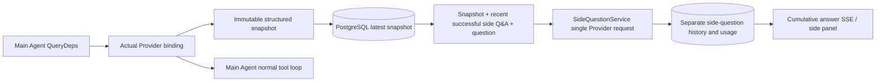

# ARTEX `/btw`

Ordinary chats, the task MainAgent and the current task's own Workers support independent side questions. Type `/btw question` in the main input box to submit; an empty `/btw` or the "Side question" button opens the history. Desktop uses a resizable side panel; mobile uses a Drawer.

Side answers are generated from the Agent context snapshot taken at submission time, and support streaming display, follow-ups, stop and clear. Closing the panel, refreshing the page or disconnecting SSE does not cancel the model request. Stop only affects the current side question; clear cancels side questions and deletes the side-question history while keeping the main context snapshot.

## Implementation boundary

Reuses Go, norma v0.3.7, Next.js and the existing Markdown / ResizablePanel / Drawer / AlertDialog components; norma's source was not modified and no dependency was added for side questions. The Planner, Workers inherited from other tasks, and upgrading tool-type subtasks are out of scope for this change.

- `capture.go` only marks main-loop requests at `Options.Deps.CallModel / CallModelSync`. The Provider decorator sits inside the concrete model, after selection by the outer routing pool, so it records the model actually selected; compaction and summary requests do not overwrite the snapshot.
- Snapshots are published at request start, on a complete model reply, and at run termination. A half-generated reply is not published; tool calls keep their pairing through norma's `MessagesForAPI`, and tool results enter the snapshot at the next main-model request or at run termination. An aborted stream keeps the previous valid boundary.
- Snapshots are deep-copied through JSON, keeping structured messages, the system prompt, tool definitions and generation parameters. Model inference holds no snapshot lock or database transaction.
- `SideQuestionService` calls the concrete Provider; when needed it first generates a side-question summary, and the final answer is allowed one shrunk retry only when the context first exceeds the limit and no text/tool call has been output yet. It creates no agent session and is not connected to the tool executor, the main transcript, the activity stream or the task graph, nor does it go through the task model-switching chain. The answer keeps the tool definitions for compatibility with the existing structured tool context; summary requests provide no tools. Newly returned tool calls have no execution path.
- One running request per parent session, at most four per service process, with a 120-second timeout per request. Side questions use their own cancellation context under the service lifecycle.
- A side request keeps a reference to the model configuration and a non-sensitive identity digest; credentials are taken from the existing configuration at request time. If the configuration is deleted, or identity fields such as the model, protocol or address change, the main Agent must run first to update the snapshot. Tests do not change the product's default model.

## Persistence and recovery

`db/schema.sql` creates `side_question_sessions` and `side_question_requests` automatically. The former stores the parent resource, latest snapshot, run number, version and clear version; the latter stores the question, cumulative answer, status, model, snapshot time, usage, event sequence number and paging ordinal.

The parent session key is the conversation ID, or task ID + exploration ID + intent ID. Workers are not keyed by reusable execution slot names.

Snapshots are merged per parent session and flushed every 250 ms; the database compares `(run_id, version)` to stop older versions from overwriting newer ones. The chosen snapshot is saved again before a side question is submitted. After a successful save the large in-memory snapshot is released; on failure the pending version is kept. The cumulative answer is written at most every 250 ms as streaming events arrive; the terminal state is saved immediately, with bounded retries on database errors.

On service start, leftover `running` requests are marked `interrupted`, keeping the partial answer and usage already persisted, without replaying the request automatically. The most recently saved context can be used directly for the next question. An old session without a snapshot requires running the main Agent first; the context is not rebuilt from UI activity records.

Clear increments the clear version and deletes requests; conditional updates stop late callbacks from writing back. Physical deletion of the parent resource relies on foreign-key cascades; logical Worker deletion removes side-question data in the same transaction and rejects later late snapshots. Task archiving first blocks new requests, waits for the main flow to stop, then cancels side questions and waits for them to be persisted; the archive format is v3, and still accepts v1/v2 without side-question tables.

History is kept in full and returned through an ordinal cursor, at most 20 entries per page. A model request replays the original text of at most the 20 most recent successful Q&A pairs, also limited by a token budget; older Q&A is kept in a separate rolling summary. When the main context is over budget, only the older part of the side-question copy is summarized, keeping recent structured tool calls and results. Summaries and preparation progress fall under the same concurrency, cancellation and 120-second timeout limits as the side question, together with their usage. See [Context budget and open-source references](CONTEXT_BUDGET.md).

## HTTP contract

The following paths serve as `{parent}`, reusing the existing authentication and resource checks:

- `/api/conversations/{id}`
- `/api/tasks/{id}/chat`
- `/api/tasks/{id}/intents/{iid}`

| Request | Response and behavior |
| --- | --- |
| `GET {parent}/side-questions?before={ordinal}` | `items` ordered newest to oldest, a separate `current` run state, `snapshot` metadata, `next_cursor`; a cursor of 0 means the latest page / no next page |
| `POST {parent}/side-questions` | JSON `{ "question": "…", "client_request_id": "UUID" }`; a new request returns 202 with the request object; the same ID and question returns the existing object with 200 |
| `DELETE {parent}/side-questions` | Cancels and clears the side questions of the current parent session |
| `GET /api/side-questions/{requestID}/events` | `snapshot` SSE events, `id` is an increasing sequence number, `data` is the complete cumulative request object; `cleared` is sent on clear |
| `POST /api/side-questions/{requestID}/cancel` | Explicit cancel; the terminal state can be read from history or SSE |

Questions are limited to 4000 characters. No snapshot, a changed model configuration, a busy parent session or an idempotency ID conflict returns 409; the global concurrency limit returns 429. Every SSE connection first sends the cumulative state and does not rely on text fragments the client received before. The frontend merges by request ID + sequence number, and discards stale callbacks when switching parent sessions or clearing.

## Validation and references

Automated checks, real model usage and known limitations are in [VALIDATION.md](VALIDATION.md).

The independent request follows [Grok CLI side-question.ts (pinned commit)](https://github.com/superagent-ai/grok-cli/blob/fb97af83f06dca873281d60168430f06c8de6324/src/utils/side-question.ts), and run isolation follows [OpenCode (pinned commit)](https://github.com/anomalyco/opencode/tree/b3f1a96c6dd7adeb28b36dd11add1998fc84d67b). ARTEX's context uses norma's structured messages instead of stitching text together from frontend logs.
